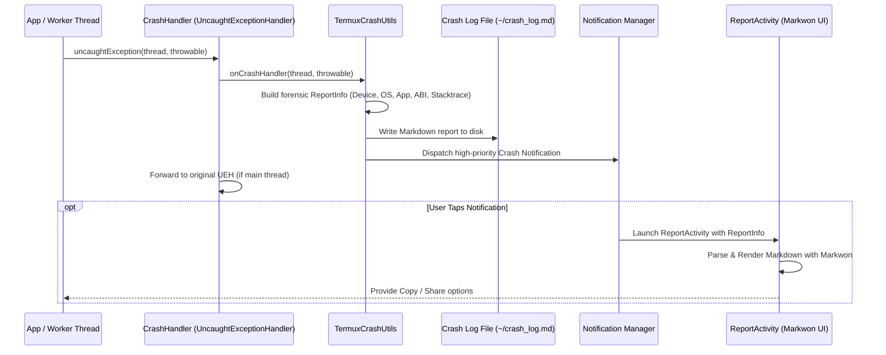

# Crash Handling & Diagnostics Architecture

The crash handling and diagnostics subsystem (`com.termux.shared.crash`, `com.termux.shared.termux.crash`, and `com.termux.shared.activities`) provides robust, process-wide exception interception, telemetry aggregation, persistent log writing, and user-facing diagnostic reporting. It ensures that crashes occurring across UI threads, background execution services, or worker threads are captured with full environmental context rather than silently terminating.

---

## Architecture & Reporting Flow

*Process-wide crash capture, disk persistence, and diagnostic display pipeline.*

---

## Core Components & Responsibilities

### 1. `CrashHandler` (`com.termux.shared.crash.CrashHandler`)
Implements `java.lang.Thread.UncaughtExceptionHandler`:
- **Registration**: Configured globally in `TermuxApplication.onCreate()` via `CrashHandler.setDefaultCrashHandler(context, client)`.
- **Chain of Custody**: Captures the previously registered handler (`mDefaultUEH`). If a crash occurs on the main UI thread, it logs and persists the crash before passing the exception upstream to ensure Android OS process cleanup semantics are preserved.
- **Worker Thread Isolation**: For non-main threads, crashes can be trapped and reported without taking down the entire foreground process if configured.

### 2. `TermuxCrashUtils` (`com.termux.shared.termux.crash.TermuxCrashUtils`)
Specialized crash reporter client bridging crash events to Termux-specific storage and notification frameworks:
- **Crash Log File**: Writes markdown-formatted crash dumps to `TermuxConstants.TERMUX_CRASH_LOG_FILE_PATH` (`/data/data/com.termux/files/home/crash_log.md`).
- **Environmental Context Collection**:
  - **App Metadata**: Version name, version code, target SDK, compile SDK, build variant (`apt-android-7`).
  - **Device & OS Information**: Manufacturer, device model, Android OS version, SDK level, security patch date, bootloader.
  - **Architecture & Runtime**: Primary and supported CPU ABIs (`arm64-v8a`, `armeabi-v7a`, `x86_64`, `x86`), kernel version.
  - **Memory & Process State**: Java heap total/free memory, max memory limit.
  - **Execution Stacktrace**: Full causative exception hierarchy and stack frames.
- **Notification Alert**: Posts a persistent high-priority notification via `TermuxNotificationUtils` containing a `PendingIntent` that routes directly to `ReportActivity`.

### 3. `ReportActivity` (`com.termux.shared.activities.ReportActivity`)
A dedicated `AppCompatActivity` for viewing diagnostic reports:
- **Markdown Rendering**: Powered by Markwon (`io.noties.markwon:core`, `io.noties.markwon:recycler`, `io.noties.markwon:linkify`), providing syntax-highlighted code blocks (`FencedCodeBlock`) and readable formatting.
- **Action Menu**: Offers **Copy to Clipboard** and **Share** intents (`ShareUtils.shareText`) allowing users to easily export crash logs for bug reports or GitHub issues.
- **Cache Management**: Cleans up temporary serialized `ReportInfo` cache files older than a configurable threshold (`deleteReportInfoFilesOlderThanXDays`).

### 4. `TextIOActivity` (`com.termux.shared.activities.TextIOActivity`)
An auxiliary diagnostic activity supporting text input/output dialogues for interactive diagnostic scripts, plugin confirmation prompts, and arbitrary command output review.

---

## Invariants & Design Principles

- **Zero-Failure Logging**: Crash report construction avoids throwing exceptions; all file writes and string formatters are wrapped in defensive try-catch guards with fallback logger output.
- **Markdown Specification**: All generated crash dumps adhere to standard CommonMark markdown, ensuring seamless copy-pasting into issue trackers and terminal markdown viewers (`glow`, `mdcat`).
- **Storage Independence**: If the home directory is inaccessible (e.g., storage corruption or permission revocation), `TermuxCrashUtils` falls back to internal app cache directories to ensure the incident report is preserved.
