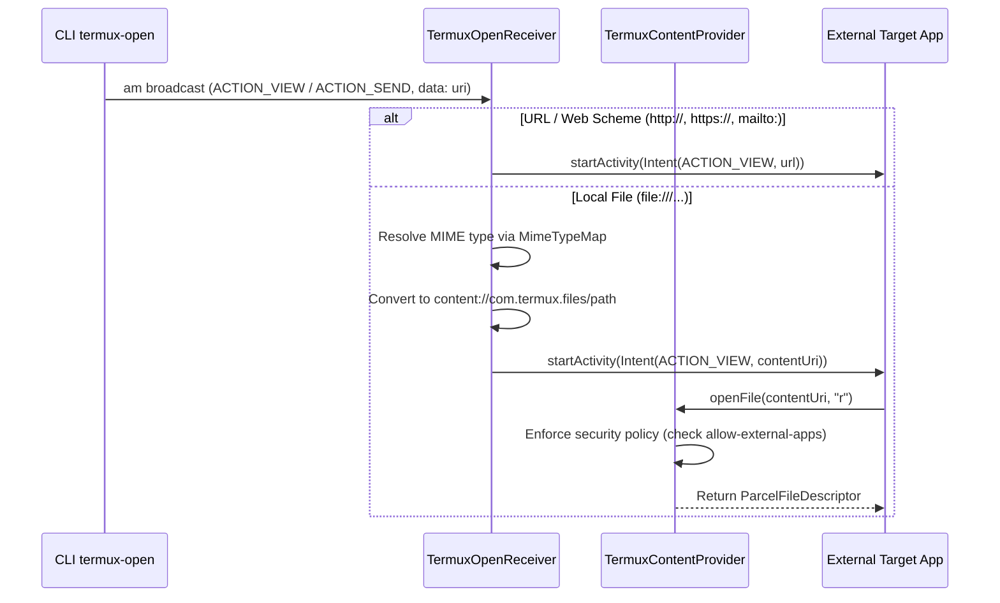

# System Event Receivers & Open Intent Dispatching

Termux integrates deeply with Android's system event framework to maintain environment consistency across app updates, device boots, external file-opening commands, and OS-level process management policies.

---

## Architecture & Broadcast Flow

```
┌────────────────────────────────────────────────────────────────────────┐
│                   SYSTEM BROADCAST & INTENT TOPOLOGY                   │
├────────────────────────────────────────────────────────────────────────┤
│                                                                        │
│   Android System Broadcasts                                            │
│   ├── ACTION_BOOT_COMPLETED ──────────────────► SystemEventReceiver    │
│   └── ACTION_PACKAGE_ADDED / REPLACED ────────► (Dynamic Filter)       │
│                                                       │                │
│                                                       ▼                │
│                                          TermuxShellManager            │
│                                          TermuxShellEnvironment        │
│                                          (Sync termux.env file)        │
│                                                                        │
│   CLI termux-open / External Share                                     │
│   ├── ACTION_VIEW / ACTION_SEND ──────────────► TermuxOpenReceiver     │
│   └── content://com.termux.files/... ─────────► ContentProvider        │
│                                                 (Read-only protection  │
│                                                  for properties files) │
│                                                                        │
│   Android 12+ Phantom Process Killer                                   │
│   └── dumpsys activity settings ──────────────► PhantomProcessUtils    │
│       / device_config activity_manager                                 │
│                                                                        │
└────────────────────────────────────────────────────────────────────────┘
```

---

## 1. System Event Receiver (`SystemEventReceiver`)

`SystemEventReceiver` is a singleton `BroadcastReceiver` responsible for lifecycle events generated by the Android framework.

### Handled Actions

| Action | Delivery Mode | Handler Method | Purpose |
|---|---|---|---|
| **`ACTION_BOOT_COMPLETED`** | Manifest Registered | `onActionBootCompleted()` | Triggers `TermuxShellManager.onActionBootCompleted()` to execute boot scripts or initialize services if configured. |
| **`ACTION_PACKAGE_ADDED`** | Dynamic Registration | `onActionPackageUpdated()` | Detects installation of Termux plugin packages (`com.termux.api`, `com.termux.tasker`, etc.) and regenerates `termux.env`. |
| **`ACTION_PACKAGE_REMOVED`**| Dynamic Registration | `onActionPackageUpdated()` | Cleans up plugin variables upon uninstallation. |
| **`ACTION_PACKAGE_REPLACED`**| Dynamic Registration| `onActionPackageUpdated()` | Re-synchronizes environment variables when a plugin package is updated. |

### Dynamic Registration Rule (Android 8+ / API 26+)
Because Android 8.0 prohibits implicit broadcast registration for `ACTION_PACKAGE_*` in `AndroidManifest.xml`, `SystemEventReceiver` provides static helpers for dynamic registration:
```java
public synchronized static void registerPackageUpdateEvents(@NonNull Context context) {
    IntentFilter intentFilter = new IntentFilter();
    intentFilter.addAction(Intent.ACTION_PACKAGE_ADDED);
    intentFilter.addAction(Intent.ACTION_PACKAGE_REMOVED);
    intentFilter.addAction(Intent.ACTION_PACKAGE_REPLACED);
    intentFilter.addDataScheme("package");
    context.registerReceiver(getInstance(), intentFilter);
}
```

---

## 2. File & URL Dispatching (`TermuxOpenReceiver`)

`TermuxOpenReceiver` handles requests from the command-line utility `termux-open` to view or share files and URLs using Android's native intent chooser.

### Execution Sequence (`onReceive`)


*Sequence diagram of URL opening and secure file sharing through TermuxOpenReceiver.*

### Content Provider Security (`TermuxOpenReceiver.ContentProvider`)
The internal provider (`authority = "com.termux.files"`) serves file descriptors to external apps with strict boundaries:
1. **Path Boundary Validation**: Paths must strictly start within `TermuxConstants.TERMUX_FILES_DIR_PATH` or `Environment.getExternalStorageDirectory()`.
2. **External Apps Policy**: Checks `TermuxPluginUtils.checkIfAllowExternalAppsPolicyIsViolated()`. If `allow-external-apps` is false, file access is rejected.
3. **Immutability of Critical Configurations**: Even if external write permissions are requested, files listed in `TERMUX_PROPERTIES_FILE_PATHS_LIST` (`~/.termux/termux.properties`) and `TERMUX_FLOAT_PROPERTIES_FILE_PATHS_LIST` are forcibly clamped to read-only mode (`mode = "r"`).

---

## 3. Android 12+ Phantom Process Killer Mitigations (`PhantomProcessUtils`)

Starting in Android 12 (API 31), the `ActivityManager` introduced a feature that monitors and kills child processes (forked background processes) if they exceed 32 concurrent processes or consume excessive CPU while the parent app is in the background.

`PhantomProcessUtils` provides diagnostics and setting inspection:
- **`KEY_MAX_PHANTOM_PROCESSES`**: Queries currently enforced limit via `dumpsys activity settings`.
- **`FEATURE_FLAG_SETTINGS_ENABLE_MONITOR_PHANTOM_PROCS`**: Checks whether phantom process trimming is enabled or disabled.
- **Guidance & Diagnostics**: Provides users with diagnostic commands (`adb shell "/system/bin/device_config put activity_manager max_phantom_processes 2147483647"`) to prevent compiler, server, and long-running subprocess terminations.

---

## Invariants & Failure Semantics

- **Singleton Event Broker**: `SystemEventReceiver.getInstance()` ensures a single instance handles broadcasts, avoiding duplicate environment regeneration calls.
- **Fail-Safe Package Filtering**: Broadcasts for non-Termux packages (`com.example.*`) are ignored immediately, preventing unnecessary I/O.
- **Security Clamping**: Critical dotfiles cannot be modified by external applications via `TermuxOpenReceiver.ContentProvider`.
