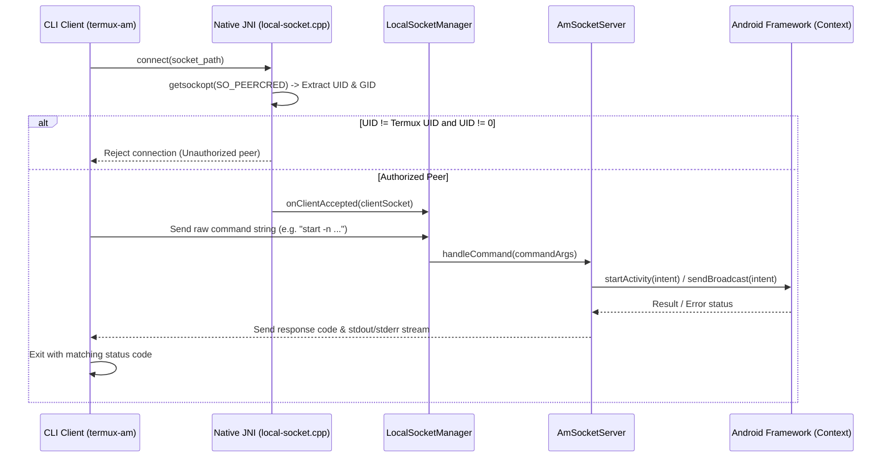

# Subprocess IPC & Android Manager Socket Server

The **Subprocess IPC & Android Manager Socket Server** (`com.termux.shared.shell.am`, `com.termux.shared.termux.shell.am`, and `termux-shared/src/main/cpp/local-socket.cpp`) is a high-performance native inter-process communication bridge. It hosts an `AF_UNIX` / `SOCK_STREAM` filesystem domain socket server within Termux that allows CLI utilities (notably `termux-am` and `termux-open`) to execute Android Activity Manager (`am`) commands directly within the host app's process space without incurring Dalvik/ART virtual machine spawn overhead.

---

## Architectural Topology & Security Boundary

Standard Android `/system/bin/am` or standalone Java wrappers spin up a dedicated Android Runtime (ART) instance for every invocation, taking hundreds of milliseconds. `TermuxAmSocketServer` bypasses this by accepting parsed command intents over a local domain socket file located at `$PREFIX/var/run/termux-am/am.sock` (or `$TERMUX_AM_SOCKET_FILE_PATH`).

```
┌─────────────────────────────────────────────────────────────────────────────┐
│                      AM SOCKET IPC TOPOLOGY & SECURITY                      │
├─────────────────────────────────────────────────────────────────────────────┤
│                                                                             │
│   CLI Process ($PREFIX/bin/termux-am)                                       │
│         │                                                                   │
│         ├── Connects via AF_UNIX domain socket ($TERMUX_AM_SOCKET_FILE)     │
│         ▼                                                                   │
│   Native JNI Layer (local-socket.cpp)                                       │
│         │                                                                   │
│         ├── getsockopt(fd, SOL_SOCKET, SO_PEERCRED, &cred)                  │
│         ├── Validates peer UID == Termux UID or UID == 0 (root)             │
│         ▼                                                                   │
│   LocalSocketManager (com.termux.shared.net.socket.local)                   │
│         │                                                                   │
│         └── AmSocketServer (Parses command line arguments)                  │
│                   ├── ActivityManager / Context.startActivity()             │
│                   ├── Context.sendBroadcast()                               │
│                   └── Context.startService()                                │
│                                                                             │
└─────────────────────────────────────────────────────────────────────────────┘
```

---

## Communication & Execution Flow



---

## Core Components & Security Specifications

### 1. `LocalSocketManager` (`com.termux.shared.net.socket.local.LocalSocketManager`)
- **Lifecycle Management**: Orchestrates socket file creation, binding, listening, and non-blocking accept loops on background worker threads.
- **Client Management**: Encapsulates active client connections (`LocalClientSocket`), handling graceful teardown, timeout bounds, and thread safety.

### 2. `PeerCred` & Native Credentials (`local-socket.cpp`)
- **`SO_PEERCRED` Inspection**: Uses native C Linux kernel socket options to retrieve the authentic kernel credentials (`pid`, `uid`, `gid`) of the connecting process.
- **Zero-Trust Access Control**:
  - Connections from unauthorized applications or other Android app UIDs are dropped immediately before any command bytes are read.
  - If executed as root (`UID 0`), the commands are downgraded to execute with the permissions, capabilities, and SELinux context of the Termux user, preventing privilege escalation.

### 3. `TermuxAmSocketServer` (`com.termux.shared.termux.shell.am.TermuxAmSocketServer`)
- **Application Wrapper**: Integrates `AmSocketServer` into `TermuxApplication`.
- **Property Gating**: Governed by `run-termux-am-socket-server` in `~/.termux/termux.properties`. If set to `false`, the socket server is not started.
- **Environment Export**: Exports `TERMUX_APP__AM_SOCKET_SERVER_ENABLED=1` into shell session environments, allowing scripts to dynamically detect whether high-speed socket dispatch is available or fallback to standard `am`.

---

## Method & API Reference

| Class / Method | Signature | Responsibility |
| :--- | :--- | :--- |
| `TermuxAmSocketServer#setupTermuxAmSocketServer` | `(Context) -> void` | Initializes and starts the local server if enabled in properties. |
| `LocalSocketManager#start` | `() -> Error` | Binds the native socket and initiates the connection listener thread. |
| `LocalSocketManager#stop` | `() -> Error` | Gracefully closes all client connections and unlinks the socket file. |
| `PeerCred#getPeerCred` | `(int fd) -> PeerCred` *(Native JNI)* | Native method calling `getsockopt(..., SO_PEERCRED)` to extract caller credentials. |
| `AmSocketServer#executeAmCommand` | `(String[]) -> int` | Parses intent flags (`-a`, `-d`, `-n`, `-e`) and dispatches to Android framework. |
