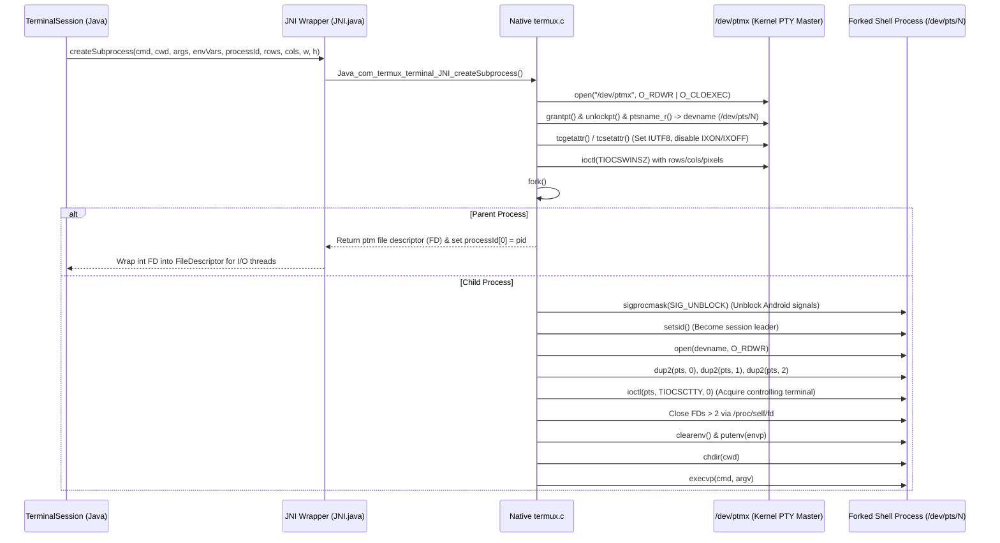

# Native JNI & Pseudoterminal (PTY) Subsystem

The native layer in Termux bridges the JVM execution runtime with the underlying Linux kernel's pseudoterminal (PTY) subsystem and local IPC Unix domain sockets. Unlike standard Android processes spawned via `java.lang.ProcessBuilder` (which use standard anonymous pipes `pipe(2)` lacking TTY semantics), Termux allocates real pseudoterminal master/slave pairs (`/dev/ptmx` and `/dev/pts/*`) to deliver full DEC/ANSI escape sequence processing, job control, signals, and window sizing to interactive command-line programs.

---

## Architecture & Subprocess Creation Flow

When a new `TerminalSession` is constructed, it delegates process spawning to `com.termux.terminal.JNI.createSubprocess()`. This native method is implemented in `terminal-emulator/src/main/jni/termux.c`.

*PTY allocation and native child process lifecycle.*

---

## Native Functions & JNI Signatures (`termux.c`)

| JNI Method | Native Function | Parameters | Return Value | Description |
|---|---|---|---|---|
| `createSubprocess` | `create_subprocess` | `String cmd, String cwd, String[] args, String[] envVars, int[] processId, int rows, int cols, int cellW, int cellH` | `int (master FD)` | Opens `/dev/ptmx`, grants/unlocks slave, configures `termios`, calls `fork()`, sets controlling terminal with `TIOCSCTTY`, executes `execvp()`. |
| `setPtyWindowSize` | `Java_com_termux_terminal_JNI_setPtyWindowSize` | `int fd, int rows, int cols, int cellWidth, int cellHeight` | `void` | Invokes `ioctl(fd, TIOCSWINSZ, &sz)` to inform the shell and ncurses apps (`htop`, `vim`) of viewport changes. |
| `setPtyUtf8Mode` | `Java_com_termux_terminal_JNI_setPtyUtf8Mode` | `int fd, boolean utf8Mode` | `void` | Toggles the `IUTF8` flag in input termios (`tcgetattr` / `tcsetattr`). |
| `waitFor` | `Java_com_termux_terminal_JNI_waitFor` | `int processId` | `int` | Executes blocking `waitpid(processId, &status, WUNTRACED)`. Returns exit code `WEXITSTATUS` or negated signal `-(WTERMSIG)`. |
| `close` | `Java_com_termux_terminal_JNI_close` | `int fileDescriptor` | `void` | System call `close(2)` to release the master file descriptor when a session terminates. |

---

## Termios Configuration & Flow Control

To ensure reliable, seamless terminal output, `termux.c` adjusts terminal input flags on the master descriptor:

1. **`IUTF8` (Input UTF-8 Mode)**:
   Enabled via `tios.c_iflag |= IUTF8` so the line discipline accurately calculates multi-byte Unicode character boundaries when processing backspace / line editing.
2. **Disabling Software Flow Control (`IXON | IXOFF`)**:
   Cleared via `tios.c_iflag &= ~(IXON | IXOFF)`. This prevents terminal lockups when users press `Ctrl+S` (which by default sends an `XOFF` flow control signal that pauses screen output until `Ctrl+Q` is received).

---

## Local Socket Security & Peer Credentials (`local-socket.cpp`)

In `:termux-shared`, `AmSocketServer` creates local Unix domain sockets (`AF_UNIX`) in the abstract namespace (or filesystem) for command execution via `am`. To enforce sandbox isolation and prevent malicious third-party apps from sending arbitrary commands:

1. **`getPeerCred(int socketFd)`**:
   Invokes `getsockopt(socketFd, SOL_SOCKET, SO_PEERCRED, &ucred, &len)` in `termux-shared/src/main/cpp/local-socket.cpp`.
2. **`PeerCred` Data Model**:
   Extracts `pid`, `uid`, and `gid` of the client process connecting to the socket.
3. **Verification**:
   `AmSocketServer` verifies that the caller's `uid` matches the Termux application UID (`Process.myUid()`), rejecting any unauthorized connection before processing incoming commands.
