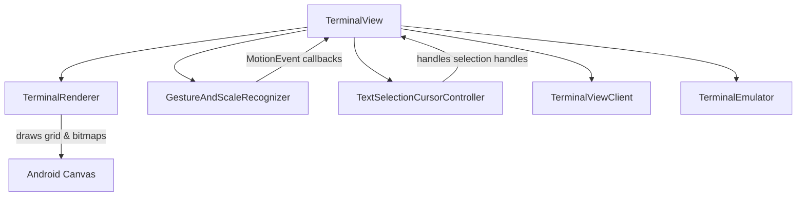
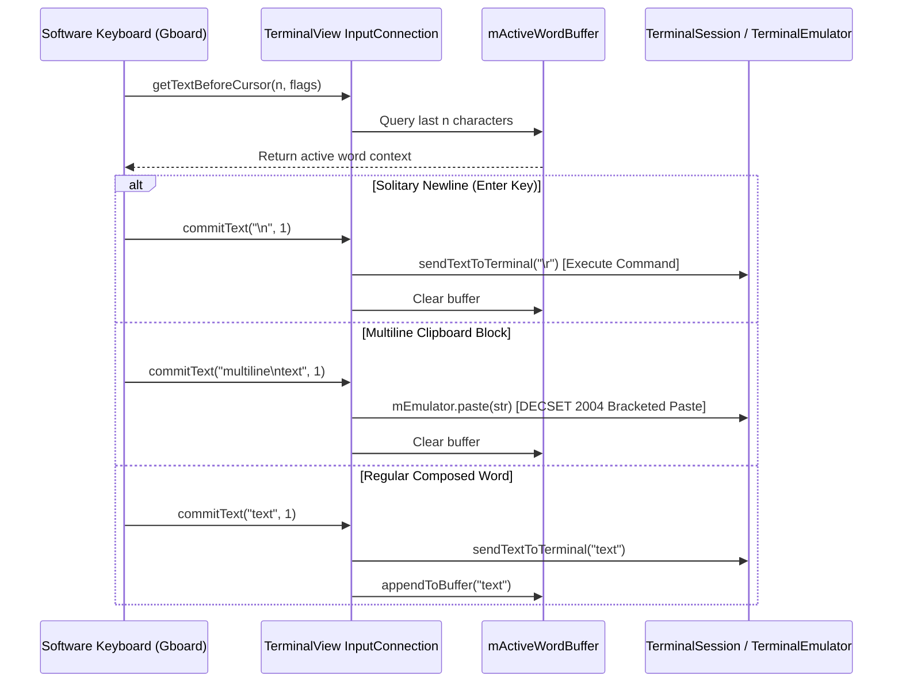

# Terminal View & Rendering

The `terminal-view` library provides the graphical Android UI component (`TerminalView`), rendering engine (`TerminalRenderer`), touch gesture recognition (`GestureAndScaleRecognizer`), and text selection controllers (`TextSelectionCursorController`, `TextSelectionHandleView`) that display and interact with a underlying `TerminalSession` and `TerminalEmulator` from `terminal-emulator`.

## Architectural Overview & Responsibilities

`TerminalView` extends Android's `View` class and acts as the central coordinator between user interactions (touch, mouse, keyboard, IME, accessibility) and the terminal emulation core.

*Architecture and component relationships in terminal-view.*

- **`TerminalView`**: The core Android `View` managing lifecycle, input connection (`InputConnection` for IMEs/keyboards), key events, mouse tracking, scroll gestures, scaling (pinch-to-zoom), autofill, accessibility, and session attachment.
- **`TerminalRenderer`**: Responsible for rendering a `TerminalEmulator` state (including transcript buffer, active grid, sixel graphics bitmaps, text styles, colors, and cursors) onto an Android `Canvas`.
- **`GestureAndScaleRecognizer`**: Combines Android's `GestureDetector` and `ScaleGestureDetector` to interpret single taps, double taps, scrolls, flings, long presses, and pinch scaling.
- **`TextSelectionCursorController`**: Manages text selection mode, touch interaction with selection handles (`TextSelectionHandleView`), clipboard copy/paste, and selection coordinates.
- **`TerminalViewClient`**: An interface allowing communication and callbacks between `TerminalView` and its container activity or application layer (e.g., Termux app).

---

## Rendering Pipeline (`TerminalRenderer`)

`TerminalRenderer` caches font metrics (`Typeface`, text size, line spacing, ascent, and character width for monospace rendering) and draws terminal rows.

### Key Rendering Steps
1. **Reverse Video / Background Clearing**: If reverse video is active, the canvas background is initialized to the foreground color.
2. **Row Iteration**: Iterates over visible screen rows from `topRow` up to `topRow + mEmulator.mRows`.
3. **Line Allocation & Sixel Support**: Fetches `TerminalRow` objects from the screen buffer. If a style entry designates a Sixel graphics bitmap (`TextStyle.isTerminalBitmap(style)`), it draws the bitmap region onto the canvas grid coordinates.
4. **Run-Length Style Grouping**: Adjacent characters sharing identical text attributes (foreground/background colors, bold, underline, italic, strike-through, dim, cursor occupancy, and selection state) are grouped into runs (`drawTextRun`) to minimize `Canvas.drawText` calls.
5. **Width Mismatch Handling**: Compares measured font widths against expected Unicode character column widths (`WcWidth.width(codePoint)`). If a font width mismatch occurs (e.g., wide emoji or non-monospaced fonts), it scales the text run to match expected column widths.
6. **Cursor Rendering**: Highlights cells occupied by the terminal cursor according to the active cursor style (block, underline, or bar) and inverts text colors for block cursors.

---

## Touch Gestures & Input Handling

Touch events are intercepted in `TerminalView#onTouchEvent(MotionEvent)` and forwarded to `GestureAndScaleRecognizer`.

### Gesture Recognition (`GestureAndScaleRecognizer`)
- **Single Tap Up**: Focuses the view, dismisses text selection if active, and triggers `TerminalViewClient#onSingleTapUp`.
- **Scroll**: Computes vertical delta rows based on font line spacing and invokes `doScroll`, updating `mTopRow` or sending mouse scroll events if mouse tracking is active.
- **Fling**: Uses Android's `Scroller` to create smooth inertial scrolling animations across transcript rows.
- **Scale (Pinch-to-Zoom)**: Adjusts the font scale factor via `TerminalViewClient#onScale`.
- **Long Press**: Triggers haptic feedback and initiates text selection mode (`startTextSelectionMode`).

### Mouse Tracking & Reporting
When terminal applications activate mouse tracking (e.g., `xterm` mouse reporting in `vim` or `tmux`), touch events outside text selection are translated into terminal mouse escape sequences (`sendMouseEventCode`) for buttons and motion events.

---

## Keyboard, IME, & Hardware Keys

`TerminalView` implements keyboard and IME handling bridging Android's text input framework with POSIX terminal semantics:

- **`onCreateInputConnection(EditorInfo)`**: Configures a customized `BaseInputConnection` wrapped with `InputConnectionCompat` supporting rich media (`contentMimeTypes` for images/GIFs), multiline text input (`TYPE_CLASS_TEXT | TYPE_TEXT_FLAG_MULTI_LINE | TYPE_TEXT_FLAG_CAP_SENTENCES`), and fullscreen prevention (`IME_FLAG_NO_FULLSCREEN | IME_FLAG_NO_EXTRACT_UI`).
- **`onKeyDown` / `onKeyUp`**: Maps hardware keyboard `KeyEvent` objects through `KeyHandler` and `TerminalEmulator` to generate correct escape sequences or character inputs.
- **Key Logging**: Optional debug logging controlled by `setIsTerminalViewKeyLoggingEnabled`.

### InputConnection Architecture & Word Buffering

Modern software keyboards (such as Gboard, SwiftKey, and Samsung Keyboard) rely on cursor context inspection (`getTextBeforeCursor`) to provide autocomplete, spell check, and gesture typing. Standard terminals do not maintain a graphical text buffer in the Android View sense. To resolve this impedance mismatch, `TerminalView` manages an internal word tracking state:

*Flow of IME input events, buffer maintenance, and terminal dispatch.*

#### Core InputConnection Mechanisms:
1. **Active Word Buffer (`mActiveWordBuffer`)**:
   - A `StringBuilder` buffer maintaining currently typed tokens up to 512 characters (trimmed to 256 on overflow).
   - Reset on solitary newlines (`\n`, `\r`) or `KEYCODE_ENTER`.
   - Updated dynamically on `appendToBuffer(CharSequence)` and `removeFromBuffer(int)`.
2. **Context Inspection (`getTextBeforeCursor`)**:
   - Returns the trailing characters from `mActiveWordBuffer`. This informs Gboard of the current word being composed and prevents duplicated words (e.g. typing `"Hola "` avoiding `"HlaHola Hola"` regressions).
3. **Autocorrect Synchronization (`commitCorrection`)**:
   - Android IMEs send `commitCorrection(CorrectionInfo)` as an informational notice while executing the substitution through `deleteSurroundingText` or `commitText`. `TerminalView` ignores redundant character re-emission in `commitCorrection`, preventing duplicate insertions.
4. **Command Execution vs. Bracketed Paste (`commitText` & `finishComposingText`)**:
   - **Solitary Newlines (`\n`, `\r`, `\r\n`)**: Treated as pressing the Enter key. Dispatches a carriage return (`\r`) directly via `sendTextToTerminal("\r")` to execute commands immediately in the interactive shell.
   - **Multiline Text Blocks**: Strings containing embedded line breaks (such as text pasted from the Gboard clipboard strip) are intercepted and routed through `mEmulator.paste(str)`. This triggers DECSET 2004 bracketed paste mode (`\033[200~` ... `\033[201~`), ensuring shells (Zsh, Bash, Fish) do not prematurely execute lines or corrupt the command prompt.
5. **Surrounding Text Deletion (`deleteSurroundingText`)**:
   - Translates deletion lengths to terminal backspaces (`\u007F` or `KeyHandler.getCode(KEYCODE_DEL)`) and forward deletes (`\033[3~` or `KeyHandler.getCode(KEYCODE_FORWARD_DEL)`), while keeping `mActiveWordBuffer` synchronized.
6. **Rich Content (`commitContent`)**:
   - Implements `InputConnectionCompat.OnCommitContentListener` to accept image payloads (PNG, JPEG, GIF, WebP) from keyboard clipboards with automatic URI permission grants (`INPUT_CONTENT_GRANT_READ_URI_PERMISSION`).

---

## Text Selection & Clipboard Operations

When a user long-presses the terminal view:
1. `startTextSelectionMode(MotionEvent)` initializes `TextSelectionCursorController`.
2. `TextSelectionCursorController` displays start and end selection handles (`TextSelectionHandleView`).
3. Users can drag handles to select text across the active screen and scrollback transcript.
4. Selected text can be copied to Android's `ClipboardManager` via actions exposed to the client.

---

## Invariants & Failure Semantics

- **Session Attachment**: `attachSession` safely updates `mTermSession` and resets transcript scrolling (`mTopRow = 0`), handling null emulators gracefully.
- **Font Metrics Cache**: `TerminalRenderer` caches font metrics; any change in font size or typeface requires instantiating a new `TerminalRenderer` instance to prevent layout corruption or incorrect line spacing.
- **Scroll Bounds**: `mTopRow` is strictly bounded between `-activeTranscriptRows` and `0`.
