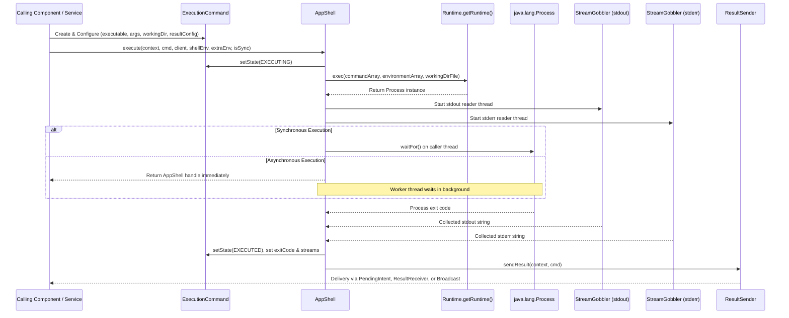

# Shell Environment & Background Execution Subsystem

Termux provides dual execution engines for running commands:
1. **Interactive PTY Execution** (`TerminalSession`): Uses pseudoterminals allocated via native JNI (`/dev/ptmx`) for full TTY semantics, terminal emulation, job control, signals, and interactive UI display.
2. **Headless Background Execution** (`AppShell`): Spawns asynchronous non-interactive subprocesses directly via `Runtime.getRuntime().exec()`, reading standard output and standard error streams through `StreamGobbler` threads and delivering results to callers via `ResultSender`.

Both execution models depend on a layered, modular shell environment subsystem rooted in `IShellEnvironment`.

---

## Architectural Topology & Component Hierarchy

```
┌────────────────────────────────────────────────────────────────────────┐
│                   SHELL ENVIRONMENT HIERARCHY                          │
├────────────────────────────────────────────────────────────────────────┤
│                                                                        │
│   IShellEnvironment (Interface: defaults, args, env setup)            │
│         ▲                                                              │
│         │ implements                                                   │
│   UnixShellEnvironment (POSIX base: HOME, PATH, TMPDIR, USER)          │
│         ▲                                                              │
│         │ extends                                                      │
│   AndroidShellEnvironment (Android base: ANDROID_DATA, ANDROID_ROOT,   │
│         ▲                  BOOTCLASSPATH, EXTERNAL_STORAGE)            │
│         │ extends                                                      │
│   TermuxShellEnvironment (Termux base: PREFIX, TERMUX_VERSION,         │
│         │                 TERMUX_APP_PID, LD_LIBRARY_PATH)             │
│         ├── TermuxAppShellEnvironment                                  │
│         └── TermuxAPIShellEnvironment                                  │
│                                                                        │
└────────────────────────────────────────────────────────────────────────┘
```

### Subprocess Execution Flow (`AppShell`)


*Sequence diagram of non-interactive command execution via AppShell and StreamGobbler.*

---

## Core Interfaces & Environment Layering

### 1. `IShellEnvironment` Interface
Contract defining baseline parameters for any executable environment:
- **`String getDefaultWorkingDirectoryPath()`**: Default working directory if unspecified (e.g., `TermuxConstants.TERMUX_HOME_DIR_PATH` or `/`).
- **`String getDefaultBinPath()`**: Default binary directory path (`$PREFIX/bin`).
- **`String[] setupShellCommandArguments(String fileToExecute, String[] arguments)`**: Prepares argument arrays, handling shebangs or shell script wrappers.
- **`HashMap<String, String> setupShellCommandEnvironment(Context context, ExecutionCommand command)`**: Constructs and returns the final environment map.

### 2. Environment Variable Layering
The environment map is generated progressively across class layers:

| Layer Class | Key Injected Environment Variables | Description |
|---|---|---|
| **`UnixShellEnvironment`** | `HOME`, `PATH`, `TMPDIR`, `USER`, `SHELL`, `TERM` | Baseline POSIX environment variables. |
| **`AndroidShellEnvironment`** | `ANDROID_ROOT`, `ANDROID_DATA`, `BOOTCLASSPATH`, `EXTERNAL_STORAGE` | Android system directory locations and runtime classpaths. |
| **`TermuxShellEnvironment`** | `PREFIX`, `TERMUX_VERSION`, `TERMUX_MAIN_PACKAGE_NAME`, `TERMUX_APP_PID` | Termux root prefix (`/data/data/com.termux/files/usr`), app version, and architecture flags. |
| **`TermuxAppShellEnvironment`** | `TERMUX_APK_RELEASE` | Release variant (e.g., `F_DROID`, `GITHUB`, `GOOGLE_PLAY_STORE`). |
| **`TermuxAPIShellEnvironment`** | `TERMUX_API_VERSION` | Injected if the Termux:API companion package is installed and queried. |

### Dynamic Environment Serialization (`writeEnvironmentToFile`)
`TermuxShellEnvironment.writeEnvironmentToFile(Context)` compiles the complete environment map into dotenv syntax (`NAME='value'`) and atomically writes it to `~/.termux/termux.env` via a temporary swap file (`termux.env.tmp`). This file allows external shell scripts or child processes to source the full environment with `. "$PREFIX/../home/.termux/termux.env"`.

---

## Non-Interactive Command Runner (`AppShell`)

`AppShell` manages the complete lifecycle of headless subprocesses:

### Execution Parameters & Method Signature
```java
public static AppShell execute(
    @NonNull final Context currentPackageContext,
    @NonNull ExecutionCommand executionCommand,
    final AppShellClient appShellClient,
    @NonNull final IShellEnvironment shellEnvironmentClient,
    @Nullable HashMap<String, String> additionalEnvironment,
    final boolean isSynchronous
)
```

### Stream Management (`StreamGobbler`)
Because operating system pipe buffers are limited (typically 64KB on Linux), unread stdout or stderr data will cause the child process to block and deadlock. `AppShell` mitigates this by spawning two daemon `StreamGobbler` threads:
- **`stdout Gobbler`**: Reads from `process.getInputStream()` asynchronously.
- **`stderr Gobbler`**: Reads from `process.getErrorStream()` asynchronously.
- Streams can be truncated safely to max buffer limits configured in `ExecutionCommand.resultConfig`.

---

## Execution State Machine (`ExecutionCommand`)

An `ExecutionCommand` encapsulates command specifications, runtime tokens, exit results, and lifecycle state:

```
[PRE_EXECUTION] ──► [EXECUTING] ──┬──► [EXECUTED] (Normal process exit)
                                  │
                                  └──► [FAILED]   (Missing executable, I/O error, or timeout)
```

- **`PRE_EXECUTION`**: Created, validated, and awaiting process dispatch.
- **`EXECUTING`**: Process launched via `Runtime.exec()`, PID assigned, I/O gobblers running.
- **`EXECUTED`**: Process completed, exit code captured, stdout/stderr strings populated in `ResultData`.
- **`FAILED`**: Command failed to launch (e.g. `R.string.error_executable_unset`) or encountered an unhandled execution error.

---

## Result Dispatching (`ResultSender`)

Once an `ExecutionCommand` reaches `EXECUTED` or `FAILED`, `ResultSender` dispatches results based on the configured `ResultConfig`:
1. **`PendingIntent`**: Dispatches results via an explicit `PendingIntent` target with standard extras (`EXTRA_RESULT_BUNDLE`, `EXTRA_STDOUT`, `EXTRA_STDERR`, `EXTRA_EXIT_CODE`).
2. **`ResultReceiver`**: Delivers results synchronously or across IPC to an Android `ResultReceiver`.
3. **`Broadcast`**: Emits an explicit broadcast intent targeting specific caller package names with permissions.

---

## Invariants & Safety Guarantees

1. **Deadlock Prevention**: Process waiting (`process.waitFor()`) is strictly ordered after `StreamGobbler` threads are actively draining pipes, preventing pipe buffer saturation deadlocks.
2. **Atomic DotEnv Swapping**: `writeEnvironmentToFile` always writes to `termux.env.tmp` before performing an atomic rename via `FileUtils.moveRegularFile`, preventing partial reads during shell sourcing.
3. **FailSafe Preservation**: When `isFailSafe == true`, `TermuxShellEnvironment` does not prepend `$PREFIX/bin` to `PATH` and leaves system `/system/bin` reachable for rescue commands.
