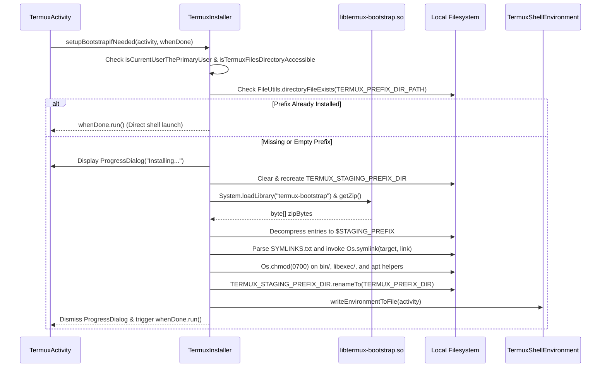

# Termux Bootstrap & Environment Installation Workflow

The **Termux Bootstrap Installation Workflow** governs the extraction, staging, permission enforcement, symlink configuration, and atomic activation of the initial Linux userland environment (`$PREFIX`, located at `/data/data/com.termux/files/usr`). It is orchestrated by `TermuxInstaller` (`com.termux.app.TermuxInstaller`), supported by native assembly/C archives (`termux-bootstrap-zip.S`, `termux-bootstrap.c`), and configured through `TermuxBootstrap` (`com.termux.shared.termux.TermuxBootstrap`).

---

## Architecture & Lifecycle Overview

On first launch—or when `$PREFIX` is empty or damaged—`TermuxActivity` invokes `TermuxInstaller.setupBootstrapIfNeeded()`. To guarantee consistency, extraction occurs in a temporary staging directory (`$STAGING_PREFIX`), preventing partial installations from leaving Termux in an unbootable state.

```
┌─────────────────────────────────────────────────────────────────────────────┐
│                   BOOTSTRAP INITIALIZATION PIPELINE                         │
├─────────────────────────────────────────────────────────────────────────────┤
│                                                                             │
│   TermuxActivity ───────► TermuxInstaller.setupBootstrapIfNeeded()          │
│                                      │                                      │
│                                      ▼                                      │
│                  Is primary Android user & files dir accessible?            │
│                       ├── NO  ──► Exit with Error Dialog & Crash Report     │
│                       └── YES                                               │
│                                      ▼                                      │
│                  Does $PREFIX exist and contain binaries?                   │
│                       ├── YES ──► whenDone.run() (Start Shell Session)      │
│                       └── NO                                                │
│                                      │                                      │
│        ┌─────────────────────────────┴─────────────────────────────┐        │
│        │ 1. Clean and initialize $STAGING_PREFIX                   │        │
│        │ 2. System.loadLibrary("termux-bootstrap")                │        │
│        │ 3. Extract native ZIP stream into $STAGING_PREFIX         │        │
│        │ 4. Parse SYMLINKS.txt & create symlinks via Os.symlink()  │        │
│        │ 5. Chmod 0700 on binaries (bin/*, libexec/*, apt/*)       │        │
│        │ 6. Atomic rename: $STAGING_PREFIX ──► $PREFIX             │        │
│        │ 7. Write environment variables to file & notify UI        │        │
│        └───────────────────────────────────────────────────────────┘        │
│                                                                             │
└─────────────────────────────────────────────────────────────────────────────┘
```

---

## Detailed Control Flow



---

## Key Components & Responsibilities

### 1. `TermuxInstaller` (`com.termux.app.TermuxInstaller`)
- **Primary User Gatekeeper**: Verifies that the current Android user is the device owner (`PackageUtils.isCurrentUserThePrimaryUser`). Multi-user secondary accounts cannot access the private app data paths (`/data/data/com.termux`).
- **External Storage Validation**: Detects if the app was erroneously installed on an external SD card, which forbids POSIX execute permissions (`noexec`).
- **Archive Streaming**: Reads the bundled bootstrap zip file directly into memory through `ZipInputStream`.
- **Symlink Setup**: Processes entries formatted as `oldPath←newPath` in `SYMLINKS.txt` and invokes `Os.symlink()`.
- **Atomic Promotion**: Executes `TERMUX_STAGING_PREFIX_DIR.renameTo(TERMUX_PREFIX_DIR)` so that any failure prior to this step does not corrupt `$PREFIX`.
- **Storage Symlinks (`setupStorageSymlinks`)**: Creates standard directory links under `~/storage`:
  - `~/storage/shared` ──► External root
  - `~/storage/downloads` ──► `Environment.DIRECTORY_DOWNLOADS`
  - `~/storage/dcim` ──► `Environment.DIRECTORY_DCIM`
  - `~/storage/pictures` ──► `Environment.DIRECTORY_PICTURES`
  - `~/storage/music` ──► `Environment.DIRECTORY_MUSIC`
  - `~/storage/movies` ──► `Environment.DIRECTORY_MOVIES`

### 2. `TermuxBootstrap` (`com.termux.shared.termux.TermuxBootstrap`)
- **Package Variant Configuration**: Manages package repository variants (`apt-android-7` vs `apt-android-5`).
- **Path Resolution**: Provides canonical constants and helpers for `$PREFIX`, `$STAGING_PREFIX`, and `$HOME`.

### 3. Native Bootstrap Module (`termux-bootstrap-zip.S` & `termux-bootstrap.c`)
- **Embedded Asset Linkage**: Compiles the bootstrap zip archive directly into the native shared library (`libtermux-bootstrap.so`) via assembly `.incbin`.
- **JNI Interface**: Exposes `Java_com_termux_app_TermuxInstaller_getZip` returning the binary byte array without relying on Android APK assets or disk extraction overhead.

---

## API & Method Reference

| Class / Method | Signature | Responsibility |
| :--- | :--- | :--- |
| `TermuxInstaller#setupBootstrapIfNeeded` | `(Activity, Runnable) -> void` | Initiates bootstrap check and background extraction if missing. |
| `TermuxInstaller#loadZipBytes` | `() -> byte[]` | Loads `libtermux-bootstrap.so` and retrieves native archive bytes. |
| `TermuxInstaller#getZip` | `() -> byte[]` *(Native JNI)* | Native C entry point returning the bundled bootstrap payload. |
| `TermuxInstaller#setupStorageSymlinks` | `(Context) -> void` | Asynchronously generates symlinks in `~/storage` to Android shared storage. |
| `TermuxInstaller#showBootstrapErrorDialog` | `(Activity, Runnable, String) -> void` | Shows retry/abort dialog and dispatches crash report notifications. |

---

## Error Handling & Diagnostics

- **Forensic Notifications**: When an error occurs during extraction, symlink creation, or permissions chmod, `sendBootstrapCrashReportNotification()` constructs a comprehensive markdown report via `TermuxCrashUtils` and posts a system notification.
- **Retry Mechanism**: The error dialog permits the user to wipe any stale staging files and re-attempt the installation without reinstalling the APK.
