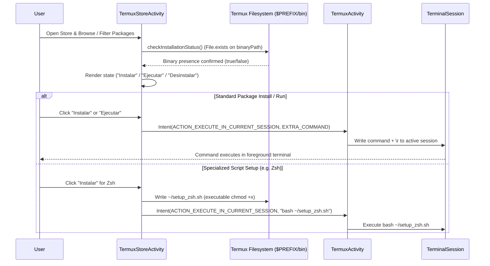

# Termux Store & Package Management Workflow

The **Termux Store** (`com.termux.app.store`) is an interactive package discovery and management subsystem within the `:app` module. It provides a curated graphical interface (Play Store styled) allowing users to search, inspect installation status, install, launch, and uninstall CLI tools, programming environments, and shell enhancements without having to manually recall APT/PKG package names or repository commands.

---

## Architecture & Interaction Flow

`TermuxStoreActivity` interacts directly with the local Termux filesystem to determine package installation state, and communicates with `TermuxActivity` to execute commands inside the active terminal session.

*Sequence of package status detection and command dispatch from Termux Store.*

---

## Core Components & Data Model

### 1. `StorePackageItem` (`com.termux.app.store.StorePackageItem`)
Represents an individual entry in the package store catalog:
- **`id`** (`String`): Unique package identifier (e.g., `"git"`, `"lazygit"`, `"zsh"`, `"neovim"`).
- **`name`** (`String`): Human-readable package title.
- **`description`** (`String`): Detailed overview of tool capabilities.
- **`category`** (`String`): Grouping category (`"desarrollo"`, `"shells"`, `"editores"`, `"utilidades"`, `"lenguajes"`, `"redes"`).
- **`iconRes`** (`int`): Resource ID of the package icon drawable (`R.drawable.ic_pkg_*`).
- **`installCommand`** (`String`): CLI command string executed to install (e.g., `"pkg install lazygit -y"`).
- **`binaryPath`** (`String`): Absolute path to the expected binary in Termux prefix (e.g., `"/data/data/com.termux/files/usr/bin/lazygit"`).
- **`launchCommand`** (`String`): Command executed when user launches the tool directly from the store (e.g., `"lazygit"`, `"nvim"`).
- **`isInstalled`** (`boolean`): Runtime flag updated via binary existence inspection.
- **`uninstallCommand`** (`String`): Optional removal command (e.g., `"pkg uninstall lazygit -y"`).

### 2. `StorePackageAdapter` (`com.termux.app.store.StorePackageAdapter`)
A `RecyclerView.Adapter` rendering package cards and handling user interaction:
- **Filtering**: Filters items in real time based on search query strings and active category chips.
- **State Presentation**: Adapts action buttons dynamically based on `item.isInstalled()`:
  - If not installed: Displays primary **"Instalar"** button.
  - If installed: Displays **"Ejecutar"** (launch) and secondary **"Desinstalar"** (uninstall) buttons.
- **Callbacks**: Dispatches action events via `OnPackageActionListener` to the parent activity.

### 3. `TermuxStoreActivity` (`com.termux.app.store.TermuxStoreActivity`)
Main activity managing the catalog lifecycle:
- **`checkInstallationStatus()`**: Runs during `onResume()` and catalog initialization. Iterates over all registered package items and checks whether `item.getBinaryPath()` points to an existing file in `$PREFIX/bin/` (`new File(item.getBinaryPath()).exists()`).
- **`executeShellCommandInTerminal()`**: Bridges package actions to the terminal session.

---

## Execution Pipelines & Session Integration

When a user taps an action button in the store, `executeShellCommandInTerminal()` prepares and routes the command:

### 1. Standard Interactive Execution (`ACTION_EXECUTE_IN_CURRENT_SESSION`)
For standard tools (such as Git, Lazygit, Node.js, Neovim):
1. Prepares intent with action `TermuxActivity.ACTION_EXECUTE_IN_CURRENT_SESSION`.
2. Attaches `TermuxActivity.EXTRA_COMMAND` set to the shell command.
3. Sets `FLAG_ACTIVITY_REORDER_TO_FRONT` to smoothly bring the terminal UI to foreground.
4. `TermuxActivity#onNewIntent()` receives the intent, extracts the command, and writes it directly to the active `TerminalSession` followed by a carriage return (`\r`), executing it immediately.

### 2. Specialized Script Setup (Zsh / Oh My Zsh Provisioning)
Complex tools requiring interactive installation scripts or multi-step environment configuration (such as `zsh`) utilize dedicated script generation:
1. `TermuxStoreActivity` intercepts package ID `"zsh"`.
2. Generates an executable script `~/setup_zsh.sh` in the user's home directory (`TermuxConstants.TERMUX_HOME_DIR_PATH`), with an automatic fallback to `getCacheDir()/store_scripts/setup_zsh.sh` if home storage write fails.
3. Sets executable permissions via `scriptFile.setExecutable(true, false)`.
4. Dispatches `bash ~/setup_zsh.sh` to `TermuxActivity` via `ACTION_EXECUTE_IN_CURRENT_SESSION`.

---

## Curated Catalog Categories

The store initializes curated packages across distinct domains:

| Category | Example Packages | Install Command | Launch Command |
|---|---|---|---|
| **Desarrollo** | Git, Lazygit, GitHub CLI (`gh`) | `pkg install lazygit -y` | `lazygit` |
| **Shells** | Zsh, Oh My Zsh, Fish | `pkg install zsh -y && ...` | `zsh` |
| **Editores** | Neovim, Nano, Micro, Helix | `pkg install neovim -y` | `nvim` |
| **Utilidades** | Tmux, Htop, Yazi, Ranger, Fzf, Bat, Eza | `pkg install tmux -y` | `tmux` |
| **Lenguajes** | Python, Node.js, Rust, OpenJDK | `pkg install python nodejs -y` | `python` / `node` |
| **Redes** | Nmap, OpenSSH, Wget, Curl | `pkg install nmap -y` | `nmap` |

---

## Invariants & Error Handling

- **Filesystem Verification**: Package installation state is strictly derived from binary presence in `$PREFIX/bin/` rather than cached APT database queries, guaranteeing instantaneous and accurate status reflection even if packages were installed or removed externally from the CLI.
- **Session Availability**: If no terminal session is currently running, `TermuxActivity` initializes the primary shell session before executing the incoming intent command.
- **UI Non-Blocking**: Binary checks and filesystem checks run lightweight file existence calls without blocking the Android UI thread.
